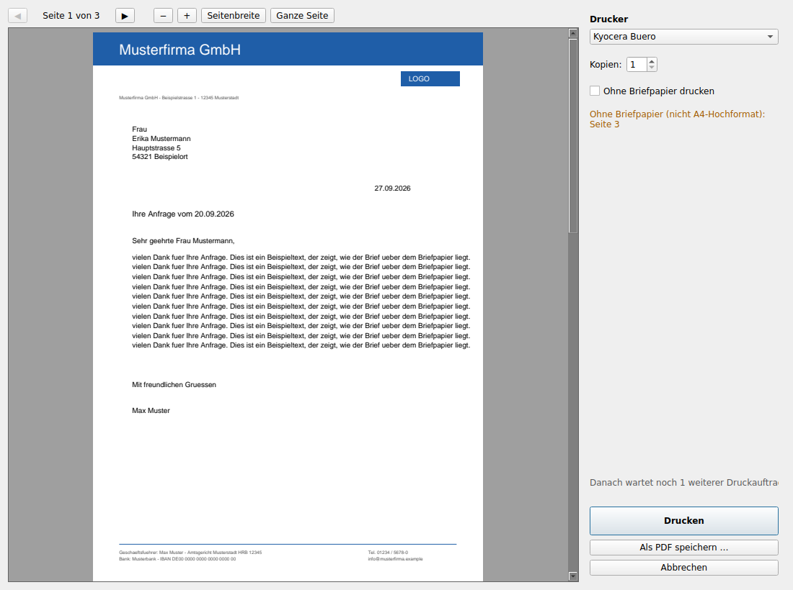

# Briefpapier – FinePrint-Ersatz

Virtueller Drucker, der jedem Ausdruck das Firmen-Briefpapier hinterlegt, eine
Vorschau zeigt und dann auf einem echten Drucker ausdruckt.

**Ablauf für die Mitarbeiter**

1. In einem beliebigen Programm *Drucken* → Drucker **„Briefpapier“** wählen
2. Das Vorschaufenster öffnet sich mit dem Dokument **inkl. Briefpapier**
3. Drucker wählen (der zuletzt benutzte ist vorausgewählt), Kopien, **Drucken**
   – alternativ *Als PDF speichern* oder *Abbrechen*



---

## Inhalt

1. [Wie es funktioniert](#1-wie-es-funktioniert)
2. [Bauen (auf einem Windows-Rechner)](#2-bauen)
3. [Installation auf einem Arbeitsplatz](#3-installation)
4. [Konfiguration](#4-konfiguration)
5. [Ordner und Dateien](#5-ordner-und-dateien)
6. [Fehlersuche](#6-fehlersuche)
7. [Update und Deinstallation](#7-update-und-deinstallation)
8. [Lizenzen der Komponenten](#8-lizenzen)
9. [Entwicklung](#9-entwicklung)

Zum Ausprobieren auf einem Test-Rechner: siehe **[TESTANLEITUNG.md](TESTANLEITUNG.md)**.

---

## 1. Wie es funktioniert

```
 Word/Excel/...                                   Briefpapier.exe (Agent, pro Benutzer, Tray-Icon)
      |  Drucken auf "Briefpapier"                  |
      v                                             |  1x pro Sekunde nachsehen
 Treiber "Microsoft Print To PDF"                   v
      |  erzeugt PDF                        fertige Datei? -> nach arbeit\<benutzer>\in_arbeit\
      v                                             |
 Port "BRIEFPAPIER:" (mfilemon)                     |  Briefpapier als Unterlage einfügen (pikepdf)
      |  schreibt jeden Auftrag als eigene Datei    v
      v                                     Vorschaufenster (Qt) -> Drucken über SumatraPDF
 C:\ProgramData\Briefpapier\spool\<benutzer>__<datum>__<job>_<nr>.pdf
```

| Komponente | Aufgabe |
|---|---|
| **Treiber „Microsoft Print To PDF“** | ist in Windows enthalten, erzeugt aus jedem Druck eine PDF. Der bekannte „Speichern unter“-Dialog kommt nur beim Port `PORTPROMPT:` – an einem anderen Port schreibt der Treiber ohne Rückfrage. |
| **mfilemon** (Port-Monitor) | schreibt jeden Druckauftrag als eigene Datei mit eindeutigem Namen (Benutzer, Datum, Job-Nr., Zähler) in den Spool-Ordner. Während des Schreibens ist die Datei gesperrt. |
| **Briefpapier.exe** (Agent) | läuft im Benutzerkontext (Autostart), überwacht den Spool-Ordner, hinterlegt das Briefpapier, zeigt die Vorschau. Nur eine Instanz pro Benutzer. |
| **SumatraPDF** | druckt die fertige PDF ohne Dialog auf den gewählten Drucker, in Originalgröße (`noscale`), damit das Briefpapier exakt sitzt. |

**Briefpapier als Unterlage:** Die erste Seite der Briefpapier-PDF wird als
Vektorgrafik *hinter* den Inhalt jeder Seite gelegt – wie echtes vorgedrucktes
Papier. Die Grafik wird pro Dokument nur einmal gespeichert.

**Robustheit:**

* Eine Datei wird erst verarbeitet, wenn sie vollständig ist: Größe 1,5 s
  unverändert, nicht mehr gesperrt, PDF-Endemarke `%%EOF` vorhanden.
* Aufträge werden sofort aus dem Spool-Ordner nach `in_arbeit\` verschoben. Stürzt
  der Agent ab oder meldet sich der Benutzer ab, erscheinen die Aufträge beim
  nächsten Start erneut.
* Mehrere Aufträge kommen in eine Warteschlange; es ist immer nur **ein**
  Vorschaufenster offen, das nächste folgt nach dem Schließen.
* Bei jedem Fehler: Meldung an den Benutzer, Originaldatei landet im Ordner
  `fehler\` (wird nie automatisch gelöscht).
* Erledigte Originale werden 7 Tage in `erledigt\` aufbewahrt (einstellbar),
  z.B. falls jemand versehentlich *Abbrechen* geklickt hat.
* Läuft der Agent nicht, sammeln sich die Aufträge im Spool-Ordner und werden
  beim nächsten Start abgearbeitet.

---

## 2. Bauen

Einmalig auf **einem** Windows-10/11-Rechner (64 Bit), z.B. dem eigenen
Admin-Rechner oder einem der Arbeitsplätze:

1. **Python 3.12** (oder neuer) von <https://www.python.org> installieren –
   dabei *„Add python.exe to PATH“* anhaken.
2. Projekt herunterladen (Git oder ZIP von GitHub) und entpacken.
3. PowerShell im Projektordner öffnen:

   ```powershell
   # Fremdkomponenten herunterladen (mfilemon, SumatraPDF) -> vendor\
   powershell -ExecutionPolicy Bypass -File tools\vendor_laden.ps1

   # Optional: Kunden-Briefpapier als briefpapier.pdf in den Projektordner legen

   # Bauen: Python-Umgebung, Tests, PyInstaller, Paket
   powershell -ExecutionPolicy Bypass -File build\build.ps1
   ```

Ergebnis:

```
paket\                        <- dieser Ordner (bzw. die ZIP) kommt auf die Arbeitsplätze
  install.cmd                    Installation / Update (Doppelklick)
  uninstall.cmd                  Deinstallation
  drucker_testen.cmd             Drucker-Test (als normaler Benutzer)
  briefpapier.pdf                Kunden-Briefpapier (falls im Projektordner vorhanden)
  Briefpapier\                   Programm (Briefpapier.exe, BriefpapierKonsole.exe, _internal\)
  installer\                     PowerShell-Skripte
  config\config.toml             Vorlage der Konfiguration
  vendor\                        mfilemon-setup.exe, SumatraPDF-x.y-64.zip
  beispiele\                     Beispiel-Briefpapier und Testdokument
Briefpapier-1.0.0.zip         <- dasselbe als ZIP
```

`BriefpapierKonsole.exe` ist dasselbe Programm mit Konsolenfenster – praktisch
zur Fehlersuche, weil das Protokoll live mitläuft.

---

## 3. Installation

Auf jedem Arbeitsplatz:

1. Paket (Ordner oder ZIP) auf den Rechner kopieren und entpacken.
   Bei einer ZIP aus dem Internet vorher: *Rechtsklick → Eigenschaften → „Zulassen“*.
2. Kunden-Briefpapier als **`briefpapier.pdf`** in den Paket-Ordner legen
   (falls nicht schon beim Bauen enthalten).
3. **`install.cmd`** doppelklicken → Administratorrechte bestätigen.
4. Als normaler Benutzer abmelden und wieder anmelden (oder im Startmenü
   *Briefpapier → Briefpapier starten*).
5. Startmenü → *Briefpapier → Briefpapier Selbsttest* ausführen: alle Zeilen
   sollten „OK“ zeigen.

Was `install.cmd` tut (`installer\install.ps1`, kann beliebig oft ausgeführt
werden, auch für Updates):

* beendet laufende Briefpapier-Programme
* kopiert das Programm nach `C:\Program Files\Briefpapier\`, SumatraPDF nach
  `C:\Program Files\Briefpapier\SumatraPDF\`
* legt `C:\ProgramData\Briefpapier\` an: `config.toml` (nur wenn noch nicht
  vorhanden!), `briefpapier.pdf`, Ordner `spool`, `arbeit`, `logs` mit
  Änderungsrecht für die Gruppe *Benutzer*
* installiert mfilemon (still), legt den Port `BRIEFPAPIER:` und den Drucker
  „Briefpapier“ (A4) an (`installer\drucker_einrichten.ps1`)
* Autostart für alle Benutzer (`HKLM\...\Run`), Startmenü-Einträge
* Protokoll der Installation: `C:\ProgramData\Briefpapier\logs\installation.log`

Optionen:

```powershell
powershell -ExecutionPolicy Bypass -File installer\install.ps1 -Briefpapier 'D:\Kunde\Briefbogen.pdf'
powershell -ExecutionPolicy Bypass -File installer\install.ps1 -ConfigUeberschreiben
```

---

## 4. Konfiguration

Datei: **`C:\ProgramData\Briefpapier\config.toml`** – alle Einträge sind dort
kommentiert (Vorlage: [`config/config.toml`](config/config.toml)).
Nach einer Änderung den Agent neu starten (Tray-Icon → *Beenden*, dann
Startmenü → *Briefpapier starten*).

> **Wichtig:** Windows-Pfade in **einfache** Anführungszeichen setzen:
> `erste_seite = 'C:\Daten\Briefbogen.pdf'`

| Abschnitt / Eintrag | Standard | Bedeutung |
|---|---|---|
| `[briefpapier] erste_seite` | `briefpapier.pdf` | Briefpapier für Seite 1 (erste Seite der PDF) |
| `folgeseiten` | leer | Anderes Briefpapier für Seite 2 ff.; leer = gleiches wie Seite 1 |
| `nicht_a4` | `weglassen` | Seiten, die nicht A4-Hochformat sind: `weglassen` (ohne Briefpapier) oder `anpassen` (Briefpapier verkleinert) |
| `toleranz_mm` | `3.0` | erlaubte Abweichung von A4 |
| `lage` | `unterlage` | `ueberlagerung` nur, falls ein Programm einen weißen Hintergrund mitdruckt (siehe Fehlersuche) |
| `[ordner] spool` | `C:\ProgramData\Briefpapier\spool` | muss zum Drucker-Port passen |
| `arbeit` | `…\arbeit` | Arbeitsordner je Benutzer |
| `log` | `…\logs` | Protokolle |
| `[drucker] ausblenden` | `[]` | weitere Drucker, die nicht zur Auswahl stehen, z.B. `['Fax', 'OneNote (Desktop)']` |
| `sumatra` | leer | Pfad zu SumatraPDF.exe; leer = neben dem Programm |
| `skalierung` | `noscale` | `noscale` = Originalgröße (empfohlen), `shrink`, `fit` |
| `druck_timeout_sekunden` | `120` | danach gilt ein Druck als fehlgeschlagen |
| `[agent] aufbewahren_tage` | `7` | erledigte Originale so lange aufbewahren; `0` = sofort löschen |
| `beenden_erlauben` | `true` | Menüpunkt *Beenden* im Tray-Icon |
| `log_stufe` | `INFO` | `DEBUG` für ausführliche Fehlersuche |

**Briefpapier austauschen:** neue PDF nach
`C:\ProgramData\Briefpapier\briefpapier.pdf` kopieren – wird beim nächsten
Druckauftrag verwendet, kein Neustart nötig.

---

## 5. Ordner und Dateien

```
C:\Program Files\Briefpapier\
    Briefpapier.exe, BriefpapierKonsole.exe, _internal\
    SumatraPDF\SumatraPDF.exe

C:\ProgramData\Briefpapier\
    config.toml
    briefpapier.pdf
    spool\                         <- hier schreibt der Drucker hin
    arbeit\<benutzer>\
        in_arbeit\                 <- aktuell angezeigte / noch offene Aufträge
        erledigt\                  <- fertig, werden nach X Tagen gelöscht
        fehler\                    <- fehlgeschlagen, werden NIE automatisch gelöscht
        temp\                      <- Zwischendateien
    logs\
        briefpapier_<benutzer>.log <- Protokoll des Agents (rotiert bei 2 MB)
        installation.log

%APPDATA%\Briefpapier\einstellungen.json   <- zuletzt gewählter Drucker, Fenstergröße
```

Hinweis Datenschutz: Die Gruppe *Benutzer* hat Änderungsrechte auf `spool` und
`arbeit`. Bei mehreren Benutzern am selben Rechner könnten diese gegenseitig
ihre Druckdateien lesen. Bei „ein Benutzer pro Rechner“ ist das unkritisch.

---

## 6. Fehlersuche

**Erste Schritte:**

1. Startmenü → *Briefpapier Selbsttest* (oder `Briefpapier.exe --pruefen`)
2. Tray-Icon → *Protokoll öffnen* (`C:\ProgramData\Briefpapier\logs\briefpapier_<benutzer>.log`)
3. Für Details: `log_stufe = 'DEBUG'` in der config.toml, Agent neu starten

**Nützliche Aufrufe** (PowerShell im Ordner `C:\Program Files\Briefpapier`):

```powershell
.\BriefpapierKonsole.exe --pruefen                        # Selbsttest mit Ausgabe in der Konsole
.\BriefpapierKonsole.exe                                  # Agent mit Live-Protokoll
.\BriefpapierKonsole.exe --vorschau C:\Temp\test.pdf      # Vorschau einer beliebigen PDF
.\BriefpapierKonsole.exe --hinterlegen ein.pdf aus.pdf    # nur PDF mit Briefpapier erzeugen
```

| Problem | Ursache / Lösung |
|---|---|
| Beim Drucken auf „Briefpapier“ erscheint ein *Speichern unter*-Dialog | Drucker hängt am Port `PORTPROMPT:` → `installer\drucker_einrichten.ps1` erneut ausführen (Port muss `BRIEFPAPIER:` sein) |
| Es passiert nichts nach dem Drucken | Läuft der Agent? (Tray-Icon, Task-Manager „Briefpapier.exe“). Liegt eine Datei in `spool\`? Wenn ja: Beginnt der Name mit dem eigenen Benutzernamen? Protokoll ansehen. Wenn nein: Druckwarteschlange von „Briefpapier“ öffnen – hängt/fehlt der Auftrag? `drucker_testen.cmd` ausführen. |
| Auftrag bleibt in der Windows-Druckwarteschlange mit Fehler | mfilemon kann nicht schreiben: Existiert `C:\ProgramData\Briefpapier\spool`? Ereignisanzeige → *Anwendungs- und Dienstprotokolle → Microsoft → Windows → PrintService* |
| Port `BRIEFPAPIER:` fehlt nach Installation | mfilemon nicht registriert: `HKLM\SYSTEM\CurrentControlSet\Control\Print\Monitors\Multi File Port Monitor` vorhanden? mfilemon-setup.exe von Hand ausführen. Unter Windows 11 prüfen, ob der **Windows Protected Print Mode** aktiv ist (Einstellungen → Bluetooth & Geräte → Drucker & Scanner) – dieser lässt keine Drittanbieter-Komponenten zu und muss aus sein. |
| Vorschau erscheint nur blinkend in der Taskleiste | Windows verhindert, dass Hintergrundprogramme Fenster nach vorne holen. Das Programm umgeht das meist; falls nicht, auf das Taskleisten-Symbol oder das Tray-Icon klicken. |
| Briefpapier fehlt in Vorschau/Druck, obwohl Seite A4 ist | Das Programm druckt einen weißen Hintergrund über die ganze Seite. Lösung: `lage = 'ueberlagerung'` in der config.toml. |
| Briefpapier fehlt auf einer Seite, Hinweis „nicht A4-Hochformat“ | gewollt (Querformat etc.); ggf. `nicht_a4 = 'anpassen'` |
| Briefpapier auf Papier leicht verschoben/verkleinert | `skalierung = 'noscale'` prüfen; Druckertreiber-Einstellung „An Seite anpassen“ o.ä. im Treiber des physischen Druckers abschalten |
| „SumatraPDF wurde nicht gefunden“ | `C:\Program Files\Briefpapier\SumatraPDF\SumatraPDF.exe` fehlt → `install.cmd` erneut ausführen (vendor\ muss die SumatraPDF-ZIP enthalten) |
| „Drucken fehlgeschlagen“ | Drucker aus/offline oder Name geändert. Im Fenster anderen Drucker wählen. Protokoll zeigt den genauen SumatraPDF-Aufruf. |
| Druckerliste leer | Selbsttest ausführen; Drucker in Windows vorhanden? |
| Meldung „Briefpapier konnte nicht hinterlegt werden“ | Briefpapier-PDF fehlt/defekt (Pfad in config.toml prüfen) oder die Druckdatei ist defekt. Das Original liegt im `fehler\`-Ordner und kann z.B. mit `--vorschau` erneut geöffnet werden. |
| Virenscanner meldet Briefpapier.exe | PyInstaller-Programme werden gelegentlich fälschlich erkannt. Ausnahme für `C:\Program Files\Briefpapier` einrichten; langfristig: Code-Signatur-Zertifikat. |
| Config-Fehler beim Start | Meldung nennt Zeile und Problem. Häufigste Ursache: Pfad in doppelten statt einfachen Anführungszeichen. |

Einen Auftrag aus dem `fehler\`-Ordner nachträglich drucken:
`BriefpapierKonsole.exe --vorschau "C:\ProgramData\Briefpapier\arbeit\<benutzer>\fehler\<datei>.pdf"`

---

## 7. Update und Deinstallation

**Update:** neues Paket bauen, auf dem Arbeitsplatz `install.cmd` ausführen.
Config und Briefpapier bleiben erhalten (außer es liegt ein neues
`briefpapier.pdf` im Paket).

**Deinstallation:** `uninstall.cmd` – entfernt Drucker, Port, Programm,
Autostart. Daten in `C:\ProgramData\Briefpapier` bleiben erhalten.

```powershell
# alles inkl. Daten und mfilemon entfernen:
powershell -ExecutionPolicy Bypass -File installer\uninstall.ps1 -DatenLoeschen -MfilemonEntfernen
```

---

## 8. Lizenzen

| Komponente | Lizenz | Hinweis |
|---|---|---|
| Briefpapier (dieses Projekt) | eigener Code | |
| Python | PSF License | in der .exe enthalten |
| PySide6 / Qt | LGPL v3 | Qt-DLLs liegen als eigene Dateien in `_internal\` (Modus „onedir“) und sind damit austauschbar – das erfüllt die LGPL-Anforderung |
| pikepdf / qpdf | MPL 2.0 / Apache 2.0 | unkritisch |
| mfilemon | GPL v3 | unverändert mitgeliefert, eigenständiges Programm – wird nicht mit unserem Code verbunden |
| SumatraPDF | GPL v3 | unverändert mitgeliefert, wird nur als eigenes Programm aufgerufen |

Da mfilemon und SumatraPDF unverändert als eigenständige Programme
weitergegeben werden, reicht es in der Praxis, dem Kunden die Lizenztexte und
den Link zum jeweiligen Quellcode mitzugeben
(<https://github.com/lomo74/mfilemon>, <https://github.com/sumatrapdfreader/sumatrapdf>).
Ghostscript (AGPL) wird bei dieser Lösung **nicht** benötigt.
*(Keine Rechtsberatung.)*

**Fallback-Varianten**, falls „Microsoft Print To PDF“ an mfilemon auf einem
Rechner nicht zuverlässig funktionieren sollte:
1. Named-Pipe-Port (lokaler Port `\\.\pipe\Briefpapier`, Agent nimmt die Daten
   direkt entgegen – keine Fremdkomponente nötig),
2. PostScript-Treiber + Ghostscript (AGPL). Der Agent arbeitet in beiden Fällen
   unverändert mit PDF-Dateien; nur die Druckereinrichtung ändert sich.

---

## 9. Entwicklung

```powershell
python -m venv .venv
.venv\Scripts\pip install -r requirements-dev.txt
$env:QT_QPA_PLATFORM = 'offscreen'; .venv\Scripts\python -m pytest -q tests; Remove-Item Env:\QT_QPA_PLATFORM

# Programm aus dem Quellcode starten (gleiche Argumente wie die .exe):
.venv\Scripts\python -m briefpapier --config config\config.toml --pruefen
```

Aufbau des Codes (alle Dateien ausführlich kommentiert):

| Datei | Inhalt |
|---|---|
| `briefpapier/agent.py` | Startpunkt, Tray-Icon, Warteschlange, Hintergrund-Thread, Selbsttest |
| `briefpapier/preview.py` | Vorschaufenster |
| `briefpapier/letterhead.py` | Briefpapier als Unterlage einfügen |
| `briefpapier/spool.py` | Spool-Ordner überwachen, fertige Dateien erkennen |
| `briefpapier/jobs.py` | Arbeitsordner in_arbeit / erledigt / fehler |
| `briefpapier/printing.py` | Druckerliste, Drucken über SumatraPDF |
| `briefpapier/config.py` | config.toml einlesen |
| `briefpapier/logsetup.py` | Protokolldatei |
| `briefpapier/singleinstance.py` | nur eine Instanz |
| `briefpapier/userstate.py` | zuletzt gewählter Drucker |
| `installer/*.ps1` | Installation, Druckereinrichtung, Test, Deinstallation |
| `build/build.ps1`, `build/briefpapier.spec` | Build mit PyInstaller |
| `tools/beispiel_pdfs.py` | Beispiel-Briefpapier und -Dokument erzeugen |
